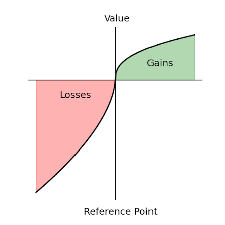
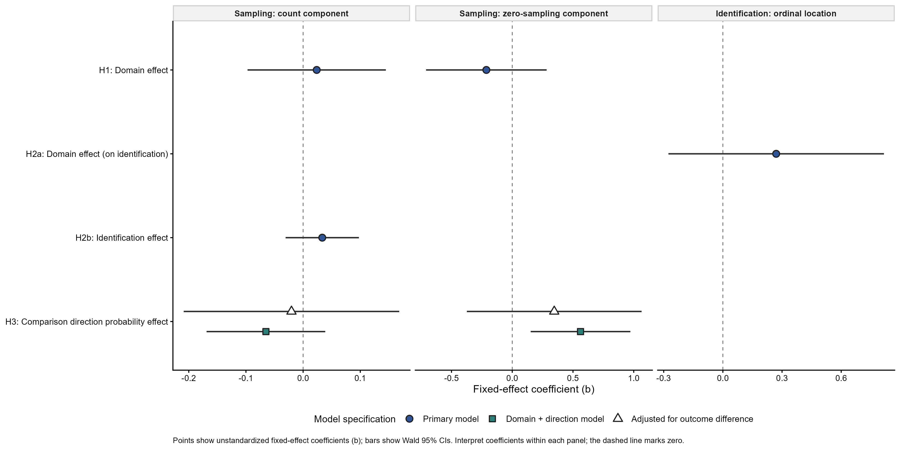
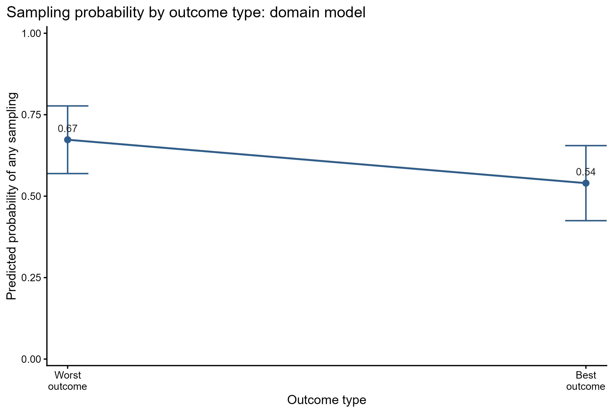
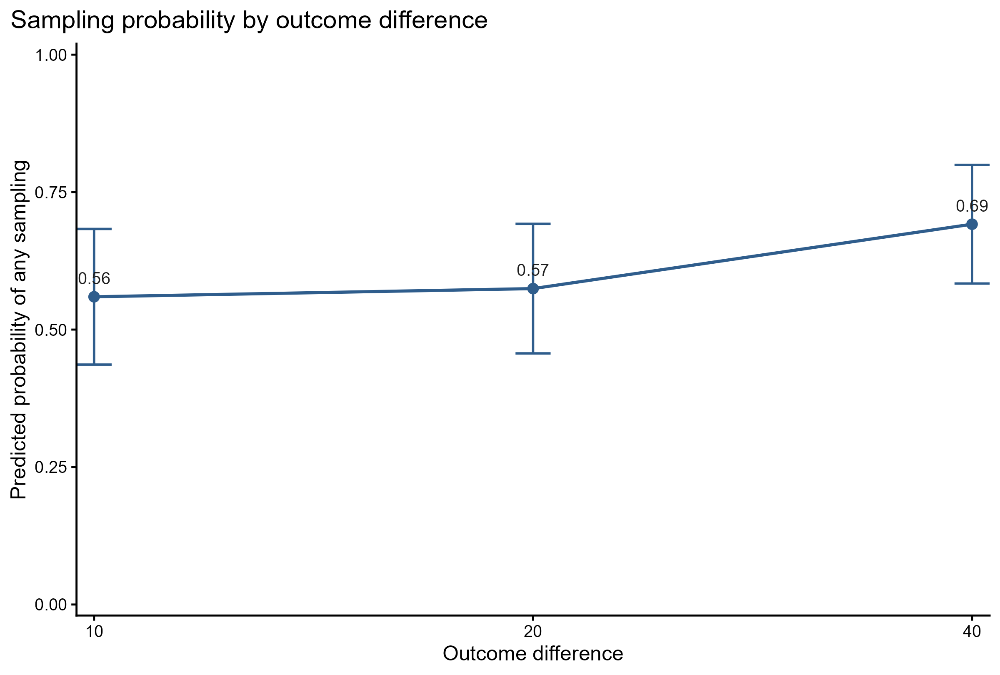
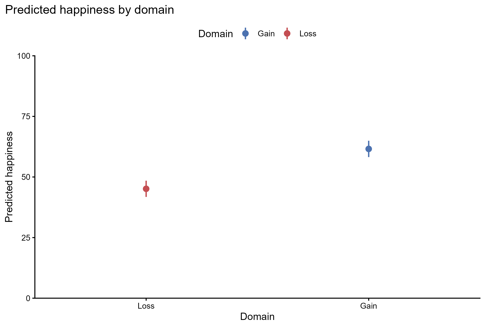
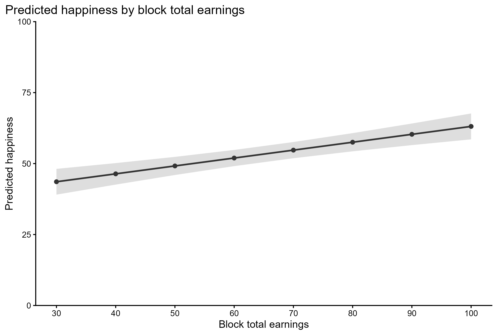
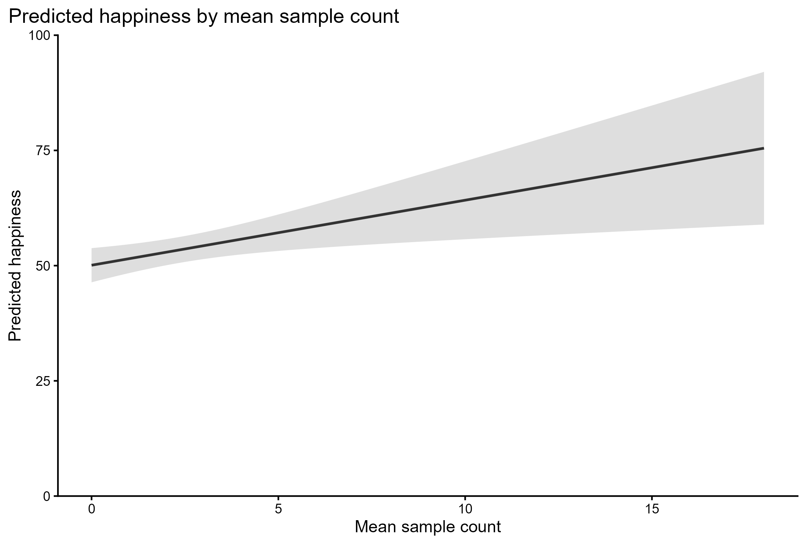
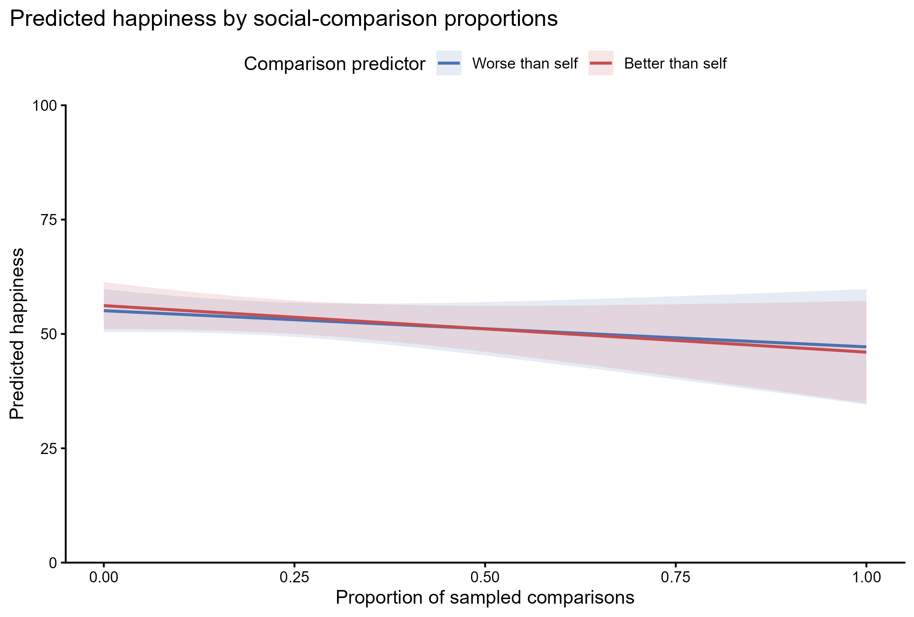

# Theoretical and Experimental Recap.

### Prospect Theory's Domains {.prospect-theory-slide}

::: {.screen-center}
{fig-alt="Prospect theory value function showing gains and losses around a reference point"}
:::

### Experimental Task

::: {.screen-center}
[Experimental Task](https://michelegarbelotto.github.io/CV/Experiment.html)
:::

# Hypotheses

### Domain Hypothesis {.hypotheses-slide}

::: {.hypothesis-stack}

::: {.fragment .fade-in .hyp-mini}
{.hyp-img fig-alt="H1"}

H1: loss domain $\rightarrow$ *less* social comparison
:::

::: {.fragment .fade-in .hyp-mini}
Why?
:::

:::

### Domain Mediated Hypotheses {.hypotheses-slide}

::: {.hypothesis-stack}

::: {.fragment .fade-in .hyp-mini}
{.hyp-img fig-alt="Non-tested hypothesis: psychological discomfort mediates the relation between domain and social comparison"}

Non-tested HP: loss domain $\rightarrow$ *more* psychological discomfort $\rightarrow$ *less* social comparison
:::

::: {.fragment .fade-in .hyp-mini}
{.hyp-img fig-alt="H2: identification mediates the relation between domain and social comparison"}

H2: loss domain $\rightarrow$ *more* identification $\rightarrow$ *less* social comparison
:::

:::

### Direction Hypothesis {.hypotheses-slide}

::: {.hypothesis-stack}

::: {.fragment .fade-in .hyp-mini}
{.hyp-img fig-alt="H3"}

H3: *higher* probability of upward comparison $\rightarrow$ *more* social comparison
:::

:::

# Results

## Explanatory Results

### Mixed-Model Hypothesis Tests {.plot-only-slide}

::: {.figure-slide}
{fig-alt="Coefficient plot of fixed-effect estimates and Wald 95 percent confidence intervals for the main hypotheses. Panels separate the conditional count, zero-sampling, and ordinal identification model components."}
:::

### H3 {.h3-summary-slide}

:::: {.h3-summary-layout}

::: {.h3-summary-plot}

:::

::: {.h3-summary-results}
#### Without Outcome Difference

`b = -0.562`, `SE = 0.209`, `p = .007`

#### With Outcome Difference

`b = -0.346`, `SE = 0.367`, `p = .346`
:::

::::

## Exploratory Results

### Model 1 {.interval-model-slide .exploratory-model-slide}

:::: {.exploratory-model-layout}

::: {.exploratory-plot-panel}
::: {.exploratory-plot}
{fig-alt="Marginal probability of any sampling by outcome difference"}
:::

::: {.interval-contrast-summary}
Outcome difference 40-20: `b = 0.513`, `SE = 0.239`, `p = .032`
Outcome difference 40-10: `b = 0.585`, `SE = 0.240`, `p = .015`
:::
:::

::: {.model-variables}

Model Variables

**Dependent variable**

Sample count

**Displayed outcome**

Probability of any sampling

**Independent variables**

- Outcome difference
- Outcome type
- Domain
:::

::::

### Model 2: Domain {.exploratory-model-slide}

:::: {.exploratory-model-layout}

::: {.exploratory-plot-panel}
::: {.exploratory-plot}
{fig-alt="Adjusted predicted happiness by domain from the domain, earnings, and sampling model"}
:::

::: {.result-caption}
Domain: `b = -16.46`, `SE = 1.88`, `p < .001`
:::
:::

::: {.model-variables}

Model Variables

**Dependent variable**

Happiness

**Independent variables**

- Domain
- Block total earnings
- Mean sample count
:::

::::

### Model 2: Block Total Earnings {.exploratory-model-slide}

:::: {.exploratory-model-layout}

::: {.exploratory-plot-panel}
::: {.exploratory-plot}
{fig-alt="Adjusted predicted happiness by block total earnings from the domain, earnings, and sampling model"}
:::

::: {.result-caption}
Block total earnings: `b = 0.28`, `SE = 0.05`, `p < .001`
:::
:::

::: {.model-variables}

Model Variables

**Dependent variable**

Happiness

**Independent variables**

- Domain
- Block total earnings
- Mean sample count
:::

::::

### Model 2: Mean Sample Count {.exploratory-model-slide}

:::: {.exploratory-model-layout}

::: {.exploratory-plot-panel}
::: {.exploratory-plot}
{fig-alt="Adjusted predicted happiness by mean sample count from the domain, earnings, and sampling model"}
:::

::: {.result-caption}
Mean sample count: `b = 1.41`, `SE = 0.53`, `p = .008`
:::
:::

::: {.model-variables}

Model Variables

**Dependent variable**

Happiness

**Independent variables**

- Domain
- Block total earnings
- Mean sample count
:::

::::

### Model 3 {.comparison-proportions-slide .exploratory-model-slide}

:::: {.exploratory-model-layout}

::: {.exploratory-plot-panel}
::: {.exploratory-plot}
{fig-alt="Adjusted predicted happiness by social comparison proportions"}
:::
:::

::: {.model-variables}

Model Variables

**Dependent variable**

Happiness

**Independent variables**

- Domain
- Block total earnings
- Proportion of comparisons worse than self
- Proportion of comparisons better than self
:::

::::

### Thanks